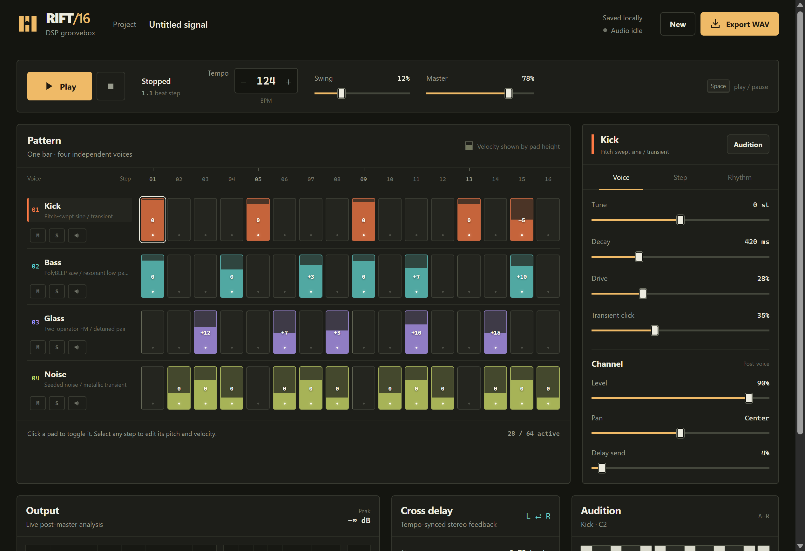

# RIFT/16

A deterministic, four-voice DSP groovebox for the browser. RIFT/16 combines a 16-step sequencer, synthesized drum and melodic voices, live AudioWorklet playback, and offline stereo WAV export—with no samples, soundfonts, third-party runtime code, or network audio dependencies.

**[Open RIFT/16 live on Vercel](https://rift-16.vercel.app)**



## Features

- **Four independent voices:** pitch-swept kick, PolyBLEP saw bass with resonant low-pass and sub oscillator, two-operator FM glass, and seeded metallic noise.
- **One-bar, 16-step sequencer:** per-step pitch and velocity, per-track mixer controls, mute/solo, swing, and Euclidean rhythm generation.
- **Live synthesis and analysis:** real AudioWorklet output, waveform and spectrum displays, stereo metering, and tempo-synced cross delay.
- **Deterministic WAV export:** 16-bit stereo PCM at 44.1 or 48 kHz, with a signal-detected effect tail.
- **Local projects:** edits autosave to browser storage; no account or backend is required.
- **Responsive interface:** narrow layouts keep the page within the viewport while the sequencer remains intentionally scrollable.

## Quick start

Requirements: **Node.js 18 or newer** and a modern browser with AudioWorklet and Web Worker support. There are no npm dependencies to install.

```sh
git clone https://github.com/Arihant-Bharanidharan/rift-16.git
cd rift-16
npm start
```

Open <http://127.0.0.1:4173/>. To use another port:

```sh
npm start -- --port 8080
```

Use the included server rather than opening `index.html` directly: it serves the AudioWorklet bundle and the other browser modules with the expected URLs.

## Controls

| Control | Action |
| --- | --- |
| **Play / Pause** or **Space** | Start, pause, and resume the pattern. |
| **Stop** | Stop playback and return to step 1. |
| **Step pad** | Toggle a trigger; select it to edit pitch and velocity in **Step**. |
| **Voice** | Adjust the selected voice's synthesis, level, pan, delay send, mute, and solo controls. |
| **Rhythm** | Generate 0–16 evenly distributed triggers with rotation, or clear the selected voice. |
| **A W S E D F T G Y H U J K** | Audition the selected voice chromatically using piano-style keyboard mapping. |
| **Ctrl/Cmd + S** | Save immediately to local browser storage. |
| **New** | Reset the project after confirmation. |

Tempo ranges from 60–180 BPM. Step pitch offsets span ±24 semitones. The audition buttons and on-screen keyboard can also trigger the selected voice or step.

## WAV export

Choose **Export WAV**, then select:

- **Length:** 1, 2, 4, 8, or 16 repetitions of the one-bar pattern.
- **Sample rate:** 44,100 or 48,000 Hz.

Rendering runs in a Web Worker using the same DSP core as live playback. The export includes the delay tail, detected from the signal and capped at 30 seconds, and reports duration, peak, RMS, and an FNV-1a fingerprint. The resulting download is 16-bit stereo PCM WAV.

Matching project state and render settings follow a deterministic render path. The committed parity evidence verifies byte-identical output for the documented real-time, direct-offline, and Worker render comparison; it is not a guarantee of identical floating-point results across every browser or CPU.

## Architecture

| File | Responsibility |
| --- | --- |
| `src/dsp-core.cjs` | Shared synthesis, sequencing, voice management, mixing, delay, master processing, offline rendering, and WAV encoding. Runs unchanged in the AudioWorklet, Worker, browser, and Node. |
| `src/worklet-processor.js` | Real-time stereo rendering in 128-frame AudioWorklet quanta, transport messages, auditions, and diagnostic capture. |
| `src/export-worker.js` | Non-blocking offline render, WAV transfer, metrics, and deterministic checksum. |
| `src/app.js` | Interface state, controls, local persistence, audio lifecycle, visualization, and downloads. |
| `server.mjs` | Dependency-free static server and `/audio-worklet.js` bundle endpoint. |
| `styles.css` | Responsive instrument layout and visual styling. |
| `tests/` | DSP unit tests, synthesis benchmark, Chrome/CDP integration verification, and real-time/offline parity diagnostic. |

## Verification

Run the deterministic DSP tests:

```sh
npm test
```

Run the synthesis stress benchmark (this overwrites the benchmark artifacts with results for the current host):

```sh
npm run benchmark
```

With `npm start` running in another terminal, run the Chrome integration check:

```sh
node tests/browser-verify.mjs
```

The browser check drives the production UI, verifies live AudioWorklet playback and an actual downloaded WAV, checks its header and established hash, exercises responsive layouts, and fails on console, request, or HTTP errors. Set `CHROME_PATH` if Chrome is not at the default Windows path, or `RIFT16_URL` to target another server. Add `--keep-open` to leave a passing browser session open.

For the manual parity diagnostic, open <http://127.0.0.1:4173/tests/parity.html> while the server is running and choose **Run real-time parity**. It compares production AudioWorklet Float32 output against direct offline rendering and the actual export Worker, then compares all three WAVs byte-for-byte.

### Recorded evidence

The committed reports in `artifacts/` document the completed verification run:

- **16/16 DSP tests passed**, including normalization, transport timing, voice stealing, finite-output guards, deterministic rendering, and WAV encoding.
- **Browser verification passed**, including editing, keyboard input, playback, WAV download validation, responsive layouts, and a clean final browser state. See [`browser-results.json`](artifacts/browser-results.json).
- **Audio parity passed:** 545,151 frames at 48 kHz, zero mismatches on either stereo channel, and byte-identical 2,180,648-byte WAVs across real-time capture, direct offline rendering, and the Worker. SHA-256: `c9c9a4e3a7a5a179fc22d2a923ca0e5085f3009e9a72d0ca4323a596b82714ae`. See [`parity-results.json`](artifacts/parity-results.json).

These are recorded results from the documented test environments, not a substitute for testing changes on your own browser and hardware.

## Benchmark results and limitations

Recorded on 2026-11-19 with Node 22.4.0 on an 11th Gen Intel Core i5-11320H. Each measured run rendered one second of 48 kHz audio in production-sized 128-frame quanta; the table reports seven runs after two warmups.

| Simultaneous voices | Median wall time for 1 s audio | Median real-time margin |
| ---: | ---: | ---: |
| 16 | 1567.586 ms | 0.64× |
| 32 | 3090.138 ms | 0.32× |
| 64 | 6057.428 ms | 0.17× |

**All three measured loads were slower than real time on this host.** A margin below 1× misses the available real-time budget. This is a single-thread synthesis/mixing stress test, **not an AudioWorklet underrun or glitch-free-playback test**. The benchmark forces exact voice concurrency and bypasses normal per-track voice stealing; 32 and 64 voices are not sequencer-reachable polyphony. Delay send, feedback, and mix are zeroed, while production mixing, delay-line writes, DC blocking, and master processing still run.

Full methodology, worst-case margins, host details, and raw timings are in [`artifacts/benchmark-results.md`](artifacts/benchmark-results.md) and [`artifacts/benchmark-results.json`](artifacts/benchmark-results.json).
